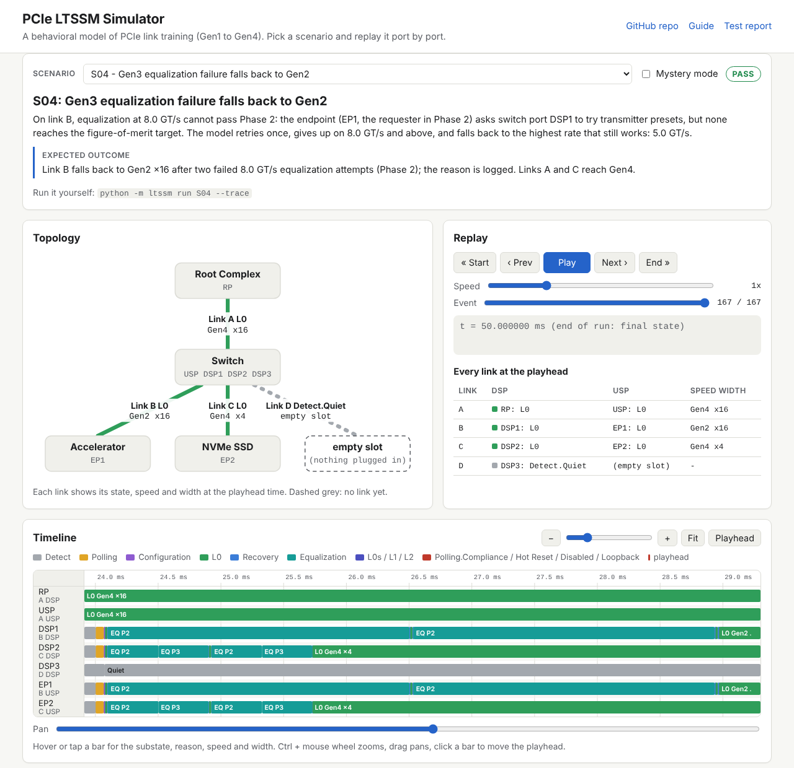
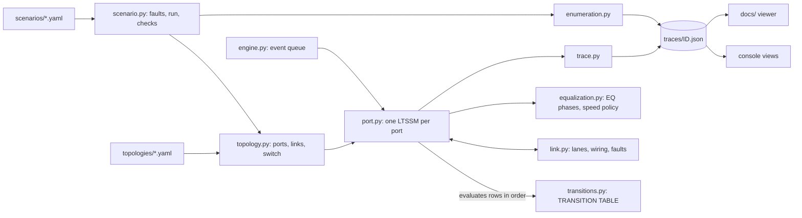

# PCIe LTSSM Simulator (Gen1 to Gen4)

[](https://github.com/fakhter-uvm014/pcie-ltssm-sim/actions/workflows/ci.yml)
[](https://fakhter-uvm014.github.io/pcie-ltssm-sim/)

A Python model of PCIe link training (the LTSSM) for a root port -> switch ->
endpoint topology, from Detect through Polling and Configuration to L0, then
Recovery-based speed changes up to 16 GT/s with four-phase equalization at
8 and 16 GT/s. Sixteen fault scenarios (dead lanes, equalization failures,
flapping, a partner that never sends TS2, surprise link-down, a software
speed cap and more) each run against a machine-checked expected outcome.
Every state change is logged with the reason and the transition-table row
that caused it, and a static web viewer replays each run as a per-port
timeline next to an lspci-style summary and notes on what the symptom means
on real hardware and how to debug it.

**Scope:** this is a *behavioral model for learning and demonstration*. It
is not spec-accurate, not cycle-accurate, and not derived from the PCI-SIG
specification text. Timeouts, counts and equalization are simplified (see
[Simplifications](#simplifications)).

**[Open the live viewer](https://fakhter-uvm014.github.io/pcie-ltssm-sim/)**



## Contents

- [Quick start](#quick-start)
- [Learn by doing](#learn-by-doing)
- [Scenarios](#scenarios)
- [How it works](#how-it-works)
- [Simplifications](#simplifications)
- [Checking against real hardware](#checking-against-real-hardware)
- [Tests](#tests)
- [Publish to GitHub](#publish-to-github)
- [References](#references)

> **New here?** [HOW-TO-USE.md](HOW-TO-USE.md) walks you through install, a 10-minute validation checklist, the viewer and a guided learning tour, step by step for Windows and Linux.
> Quickest way to open the viewer locally: `python scripts/view.py`.

## Quick start

Python 3.10 or newer. Run everything from the repository root.

<table>
<tr><th>Linux / macOS</th><th>Windows (PowerShell)</th></tr>
<tr><td>

```sh
python3 -m venv .venv
source .venv/bin/activate
pip install -e ".[dev]"
python -m ltssm list
python -m ltssm run S04
python -m ltssm run-all
pytest
python -m http.server --directory docs 8000
```

</td><td>

```powershell
py -m venv .venv
.venv\Scripts\Activate.ps1
pip install -e ".[dev]"
python -m ltssm list
python -m ltssm run S04
python -m ltssm run-all
pytest
python -m http.server --directory docs 8000
```

</td></tr>
</table>

Then open <http://localhost:8000/> for the viewer. (Opening `docs/index.html`
directly from disk does not work, because browsers block `fetch()` for local
files.) If PowerShell refuses to run the activation script, run
`Set-ExecutionPolicy -Scope CurrentUser RemoteSigned` once.

Useful commands:

| Command | What it does |
|---|---|
| `python -m ltssm list` | All scenarios with their expected outcome |
| `python -m ltssm explain S07` | Learning notes: what to look for, root causes, how to debug |
| `python -m ltssm run S04` | Run one scenario (ID or YAML path), print the summary; exit code 0 if it matches the expected outcome |
| `python -m ltssm run S04 --trace --port DSP1,EP1` | Also print the event log, with the reason for every step |
| `python -m ltssm run S06 --hidden` / `--reveal` | Mystery mode: symptoms only / the answer and notes |
| `python -m ltssm quiz` (`--seed N --answer N`) | A random hidden scenario and a multiple-choice diagnosis |
| `python -m ltssm lspci S06` | The result as an `lspci -vvv`-style excerpt per port |
| `python -m ltssm enumerate S09` or `basic` | The `lspci -t`-style bus tree with primary/secondary/subordinate buses |
| `python -m ltssm run-all` | Run everything, write `traces/` and publish to `docs/traces/` |
| `python -m ltssm table` | Print the transition table |

After `pip install -e .` the same commands are available as `ltssm ...`.

## Learn by doing

1. `python -m ltssm run S01 --trace --port RP,USP` and read it next to the
   narrated bring-up in [how-it-works.md](docs/guide/how-it-works.md). This
   is your healthy baseline.
2. Open S01 in the viewer, press **Start**, then **Next** repeatedly and
   watch link A go Detect -> Polling -> Configuration -> L0 -> Gen3 -> Gen4.
3. Compare S13 (different speed policy), then S02 and S16 (slower, but
   nothing failed).
4. Width and lanes: S06, S12. Equalization: S04, S05.
5. Links that never come up: S03, S09, S08. Recoveries: S07, S15, S11.
   Links going down: S10, S14.
6. Mystery mode: `python -m ltssm quiz`, or tick **Mystery mode** in the
   viewer, and use the [debug guide](docs/guide/debug-guide.md) to reason
   from symptoms to causes before pressing **Reveal**.

Guides: [how it works](docs/guide/how-it-works.md) |
[what to expect](docs/guide/what-to-expect.md) |
[debug guide](docs/guide/debug-guide.md) |
[interpreting results](docs/guide/interpreting-results.md) |
[scenario catalog](docs/guide/scenario-catalog.md) |
[real hardware](docs/guide/real-hardware.md) |
[transition table](docs/guide/transition-table.md) |
[glossary](docs/guide/glossary.md)

## Scenarios

| ID | Scenario | Fault or stimulus | Expected outcome |
|---|---|---|---|
| S01 | Clean Gen4 bring-up | none | A and B at Gen4 x16, C at Gen4 x4 (x4 SSD), D empty; 7 functions |
| S02 | Mixed capability | Endpoint 2 supports Gen2 only | Link C at Gen2 x4, no equalization; others Gen4 |
| S03 | Receiver not detected | Empty slot on downstream port 3 | Link D cycles Detect.Quiet <-> Detect.Active, never Polling |
| S04 | Gen3 EQ failure | 8 GT/s EQ Phase 2 fails on link B | Two failed attempts, link B falls back to Gen2; reason logged |
| S05 | Gen4 EQ failure | 16 GT/s EQ Phase 3 fails, 8 GT/s passes | Link B settles at Gen3 |
| S06 | Lane failure | Lanes 8-15 open on link A | Link A trains at Gen4 x8 |
| S07 | Link flapping | Six receiver errors in L0 | Six L0 <-> Recovery flaps, flap_count = 6, no link-down |
| S08 | Stuck in Polling | Partner never sends TS2 | Polling.Configuration timeout -> Detect; never L0 |
| S09 | Upstream link down | Link A never trains | Switch downstream ports wait; only the root port enumerates |
| S10 | Hot Reset | Host issues Hot Reset at 35 ms | Every switch link retrains; final state matches S01 |
| S11 | ASPM L1 | Idle link enters L1, traffic wakes it | L0 -> L1 -> Recovery -> L0 twice, no errors |
| S12 | Lane reversal | Lanes wired in reverse | Full width; endpoint applies lane reversal |
| S13 | Speed policy comparison | `gen2_step: true` | Gen1 -> Gen2 -> Gen3 -> Gen4; same final state as S01 |
| S14 | Recovery fails, link down | Every lane of link B opens at 32 ms | RcvrLock timeout -> Detect, DL_Down, EP1 gone |
| S15 | Marginal lane | Lane 5 corrupts 0.1% of ordered sets at Gen4 | Recovery storm (>= 10 flaps) blamed on lane 5 |
| S16 | Software speed cap | Target Link Speed = Gen3 on DSP1 | Link B at Gen3 with no failures |

Each scenario file in `scenarios/` also holds `what_to_look_for`,
`likely_root_causes`, `how_to_debug` and mystery-mode hints. Details:
[scenario catalog](docs/guide/scenario-catalog.md).

## How it works



* **Discrete-event engine** with integer nanosecond time; same seed,
  byte-identical trace.
* **Ports exchange symbolic ordered sets** (TS1, TS2, EIOS, EIEOS, SKP, FTS,
  idle) in bursts through a **Link** that applies per-lane faults: open or
  silent lanes, reversed wiring, seeded drop/corrupt rates per rate,
  a transmitter that never sends TS2, periodic L0 errors, connection loss.
* **Each port's LTSSM dispatches through one transition table**
  (`ltssm/transitions.py`): rows of source substate, condition, guard,
  next substate, action and the rule it models. Every trace event carries
  the row id. Read the table first: [transition-table.md](docs/guide/transition-table.md).
* **Speed change and equalization:** Gen1 first, then Gen3 (EQ phases 0-3:
  the USP tunes the DSP's transmitter in Phase 2, the DSP tunes the USP's in
  Phase 3), then Gen4 with its own EQ. An EQ failure reverts to the previous
  rate, and after two failures the DSP gives up on that rate and tries the
  next lower one. `gen2_step` and Target Link Speed are configurable.
* **Switch:** an upstream port and three downstream ports that wait for
  link A (or start together), with Hot Reset propagation.
* **Enumeration** after training: depth-first bus numbering, Type 0/1
  headers, Vendor ID 0xFFFF behind links that are not up.
* **Checks:** each scenario's expected outcome plus global invariants (no
  L0 at 16 GT/s without 16 GT/s EQ, never try 16 GT/s before 8 GT/s EQ, switch
  ports wait for the upstream link, every transition matches a table row).

## Simplifications

- Timeouts and ordered-set counts are approximate and configurable
  (`ltssm/config.py`); Recovery timeouts are shortened to 2 ms.
- Equalization is modeled as pass/fail per phase with symbolic presets and
  a symbolic figure of merit, not real coefficients or eye measurements.
- No data link or transaction layer; DL_Link_Active is a timed flag and the
  ASPM handshake is symbolic.
- L0s, L2, Loopback and Disabled are minimal; Hot Reset, Disabled and
  Loopback are entered from Recovery.RcvrCfg.
- Ordered sets are symbolic objects exchanged in bursts, not encoded bits.
- Width is the widest supported width starting at lane 0; receiver
  detection is per lane, all-or-nothing.
- No Gen5/Gen6, PAM4 or FLIT mode; no retimers.
- Not validated against the PCI-SIG specification text.

## Checking against real hardware

The link-status values the model prints (speed, width, Link Training,
DL_Link_Active, Target Link Speed, the equalization status bits) are named
after real registers, so you can practice on the model and then check a real
machine. The figure of merit, the flap and recovery counters and the rate
ceiling are model-only bookkeeping with no register behind them.

```sh
lspci -tv                                   # where the device sits
sudo lspci -s 03:00.0 -vvv | grep -E "LnkCap|LnkSta|LnkCtl2|DLActive|Equalization|Phy16"
cat /sys/bus/pci/devices/0000:03:00.0/current_link_speed
cat /sys/bus/pci/devices/0000:03:00.0/max_link_speed
```

* Compare `LnkSta` (current speed and width) with `LnkCap` of **both** ends.
  Below the lower of the two is the interesting case. pciutils 3.8+ prints
  `(downgraded)` only on upstream-facing ports (switch upstream ports,
  endpoints), so on root and downstream ports compare the numbers yourself.
* If the speed is lower than both: check `LnkCtl2: Target Link Speed` on
  the downstream port first (S16), then the equalization bits in `LnkSta2`
  and the 16 GT/s status (S04, S05).
* If the width is lower than both: check slot wiring and bifurcation, then
  the lanes (S06).
* Flapping: AER correctable error counters and per-lane error status (S07,
  S15). LnkSta `BWMgmt`/`ABWMgmt` report speed/width changes and are not a
  reliable sign of same-rate recoveries.

[real-hardware.md](docs/guide/real-hardware.md) explains each field,
retraining with `setpci` on a test system (with the cautions), sysfs AER
counters, and the Windows options (Device Manager details, PowerShell
`Get-PnpDeviceProperty`, vendor tools).

## Tests

```sh
pytest                                         # all tests
pytest --html=report.html --self-contained-html  # HTML test report
pytest tests/test_scenarios.py -k S04 -v        # one scenario
```

- `tests/test_scenarios.py`: one test per scenario written as a test plan
  (Test ID / Purpose / Stimulus / Expected result), plus forbidden-transition
  rules applied to every scenario.
- `tests/test_transitions.py`: table structure, every row reachable, the
  port really dispatches through the table, optional rows exercised.
- `tests/test_ordered_sets.py`, `test_enumeration.py`, `test_determinism.py`,
  `test_cli.py`, `test_repo.py`.

CI (`.github/workflows/ci.yml`) runs the tests on Ubuntu and Windows with
Python 3.10 and 3.12, regenerates the traces, and on `main` publishes
`docs/` (viewer, traces and the test report under `report/`) to GitHub
Pages.

## Repository layout

```
pcie-ltssm-sim/
  ltssm/           simulator package (start with transitions.py)
  scenarios/       S01-S16 scenario files with learning notes
  topologies/      basic.yaml (root -> switch -> 2 endpoints + empty slot), point_to_point.yaml
  tests/           pytest suite
  traces/          generated traces (git-ignored)
  docs/            GitHub Pages viewer (index.html, app.js, style.css, traces/)
  docs/guide/      learning guides
  scripts/         run_all.py, set_github_user.py
```

## Publish to GitHub

```sh
git init
git add .
git commit -m "PCIe LTSSM behavioral simulator"
git branch -M main
git remote add origin https://github.com/fakhter-uvm014/pcie-ltssm-sim.git
git push -u origin main
```

Then in the repository settings, under **Pages**, set **Source** to
**GitHub Actions**. The next push to `main` runs the tests and deploys the
viewer to `https://fakhter-uvm014.github.io/pcie-ltssm-sim/`.

Publishing under a different GitHub account? Run
`python scripts/set_github_user.py NEWNAME` first; it rewrites the links in
the README, CONTRIBUTING, pyproject and docs.

## References

- R. Budruk, D. Anderson, T. Shanley, *PCI Express System Architecture*, MindShare.
- MindShare, *PCI Express Technology 3.0*.
- Vendor application notes and IP documentation on LTSSM and link equalization.
- Linux kernel PCI subsystem (`drivers/pci/`) and the `lspci` / `setpci` tools (pciutils).

## License

MIT, see [LICENSE](LICENSE).

Author: Farzana Akhter
