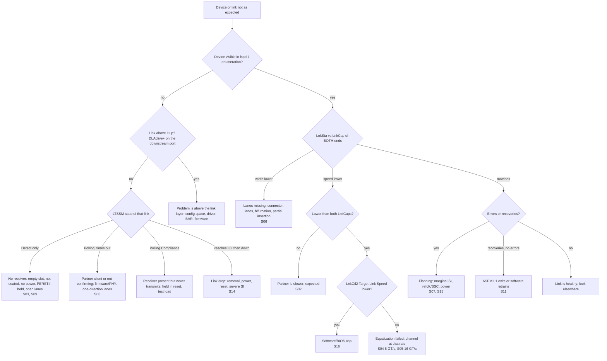

# Debug guide

Symptom -> what the trace shows -> likely causes -> how to confirm. Each row
points at a scenario you can run to see the pattern. The "likely causes"
column is about real boards and silicon; treat it as a list of suspects to
check in order, not as a diagnosis.

Commands you will use in the model:

```
python -m ltssm run S04 --trace --port DSP1,EP1   # event log for one link
python -m ltssm lspci S04                         # LnkCap / LnkSta / LnkSta2 view
python -m ltssm run S06 --hidden                  # practice: symptoms only
```

## Decision flow



## Symptom table

| Symptom | What the trace shows | Likely causes on real hardware | How to confirm |
|---|---|---|---|
| **No link at all / stuck in Detect** (S03, S09) | Only grey Detect bars; `T04` "no receiver termination detected on any lane" every 12 ms; `detect_cycles` keeps growing; never a Polling bar. | Slot empty; card not seated; card unpowered or held in reset (PERST#); missing reference clock (the device may never enable its receivers); open AC-coupling capacitors or a disconnected cable/riser. | `lspci -vvv` on the downstream port: `LnkSta: Width x0`, `DLActive-`. Check presence detect, power rails, PERST# and REFCLK with a scope or the platform's power-sequencing log. Read the port's LTSSM state from vendor debug registers if available. Swap card and slot. |
| **Stuck in Polling** (S08) | Polling.Active completes (`T05`), then a long amber Polling.Configuration bar ends in `T11` "Polling.Configuration timeout ... last received: TS1". The partner's swimlane disagrees (it thinks it moved on). | Partner firmware or PHY defect; lanes that work in one direction only; a retimer forwarding only one direction; a partner stuck in a test mode. | Read LTSSM state on both ends; a protocol analyzer shows TS1 where TS2 should be. Try a different partner device in the same slot. |
| **Polling.Compliance** (unit-test exercise `silent_partner_polling_compliance`) | `T07` "receiver detected but no lane ever left Electrical Idle", then a red Polling.Compliance bar until `T09` "partner started transmitting". | Partner powered enough to terminate but held in reset or not running firmware; a passive test load on purpose; a transmitter that never starts. | On a scope the downstream port sends a fixed test pattern instead of training sets. Check the partner's reset and power sequencing. |
| **Wrong width** (S06) | `T03` "receiver termination detected on lanes 0-7 (8 of 16)" and `T15` "width x8 selected ... port supports x16". Speed is fine. | Damaged or dirty connector pins; partially inserted card; broken lanes or missing capacitors; slot bifurcation set to x8x8; slot wired x8 behind an x16 connector. | `lspci -vvv` on both ends: LnkSta `Width x8` while LnkCap says x16 (pciutils 3.8+ adds `(downgraded)` only on the upstream-facing end; compare the root/downstream port yourself). Compare `current_link_width` and `max_link_width` in sysfs. Check BIOS bifurcation. Reseat, swap slot or riser. Check per-lane error status if exposed. |
| **Wrong speed, partner slower** (S02) | Only one speed step; reason "link target is Gen2 because partner advertised up to Gen2". No equalization bars. | Older device, firmware cap on the device, a Gen-limited riser or retimer. | `lspci -vvv` on the device: its LnkCap / LnkCap2 list the lower speed. Expected behavior. |
| **Speed lower than both caps, no failures** (S16) | One successful equalization at 8 GT/s, then nothing; the speed-change reason says "Target Link Speed (LnkCtl2) is Gen3". | BIOS "PCIe speed" option, a driver or tool writing Target Link Speed, platform policy for the slot. | `lspci -vvv` on the downstream port: `LnkCtl2: Target Link Speed`. Raise it and retrain on a test system (see [real-hardware.md](real-hardware.md)). |
| **EQ fails at 8 GT/s** (S04) | Teal blocks at Gen3 ending in `T62`/`T65` "Phase N FAILED ... none of 6 presets reached FOM 60", Recovery.Speed back to Gen1, a retry, then "rate ceiling lowered to Gen2" and a plain Gen2 step. lspci: Phase2- (or Phase3-) and `LinkEqualizationRequest+`; the model keeps `EqualizationComplete-`, but on hardware Complete may read + after an unsuccessful attempt depending on the implementation, so read the per-phase bits and LinkEqualizationRequest first. | Channel loss too high at 8 GT/s; preset/coefficient settings or firmware EQ overrides wrong for this channel; retimer misconfiguration; marginal SI (crosstalk, reflections). Phase 2 failure points at the downstream direction, Phase 3 at the upstream direction. | Force 8 GT/s (Target Link Speed + Retrain Link) and watch it fall back; check AER correctable counters at that speed; compare EQ settings with a known-good board; margin or eye measurements per lane and direction. |
| **EQ fails at 16 GT/s** (S05) | 8 GT/s EQ passes; 16 GT/s blocks fail; the link reverts to Gen3 (not Gen1). lspci: LnkSta2 Complete+ (8 GT/s); the 16 GT/s status shows EquPhase3- and LinkEquRequest+ (and EquComplete- in the model; on hardware Complete may read + after a failed attempt, so trust the phase bits first). | Channel fine at 8 GT/s but too lossy at 16 GT/s; board/riser/cable rated for Gen3; missing retimer. | 16 GT/s Physical Layer capability in lspci; Lane Margining at the Receiver on 16 GT/s parts; try a shorter channel. |
| **Link flapping** (S07) | Narrow blue Recovery bars at regular intervals, reason "receiver error in L0"; RcvrLock -> RcvrCfg -> Idle with no Recovery.Speed; `flap_count` equals the number of errors; no link down. | Marginal SI at the current rate; reference clock problems (SSC on one side only, separate clocks without SRIS support); power noise; marginal connector or retimer. | AER correctable errors (Receiver Error, Bad TLP, Bad DLLP) increasing; dmesg "AER: Corrected error received"; lower the target speed and see if errors stop. Do not rely on LnkSta `BWMgmt`/`ABWMgmt`: they report speed/width changes, and same-rate recoveries need not set them; the AER counters are the indicator. |
| **Recovery storm on one lane** (S15) | Many irregular Recovery bars after reaching Gen4 only; every error reason says "lane 5". | One weak lane: connector pin, via, crosstalk hot spot, a marginal EQ result on that lane. | Lane Error Status (LaneErrStat) in the Secondary PCI Express capability; per-lane margining; swap slot/cable to see if the bad lane follows the card. |
| **Link goes down** (S14) | L0 -> Recovery.RcvrLock with "receiver lost signal", 2 ms of TS1 with nothing received (`T46` "Recovery.RcvrLock timeout ... link down"), DL_Down status, then Detect cycles with no receiver. | Surprise removal, power loss, device reset or crash, cable disconnect, retimer reset, severe SI. | dmesg: link down / hot-plug messages, AER Surprise Down or DPC events; SltSta on hot-plug slots; device logs; check whether a rescan brings it back. |
| **Device missing from enumeration** (S09, S14, S08) | Enumeration block says "not found - link X is not up (DL_Link_Active=0), Vendor ID read returns 0xFFFF". | The link below the parent bridge is not up: debug that link first (rows above). If the link is up, the problem is in configuration space or firmware, not the LTSSM. | `lspci -t` shows the bridge with an empty bus range; `lspci -vvv` on the bridge shows `DLActive-`. |
| **Switch downstream links never train** (S09) | DSP1-3 show one Detect.Quiet bar for the whole run and a status "held in Detect.Quiet: switch upstream link A not in L0 yet"; endpoints show "no receiver". | The switch's upstream link is down, so the switch keeps its downstream ports in reset; switch firmware not loaded; switch held in reset. | Fix the upstream link first. In the model, rerun with `config: {dsp_start: together}` to see the difference in the timeline. |
| **Recoveries with no errors** (S11) | Indigo L1 bars, each followed by Recovery and L0 at the same rate; `recovery_causes` shows "L1 exit"; flap_count 0. | ASPM L1 power management (normal). Problems arise only if a device cannot tolerate the exit latency. | `lspci -vvv`: LnkCtl ASPM setting; disable ASPM (kernel parameter `pcie_aspm=off` or BIOS) and compare. |
| **All links retrain at once** (S10) | A "software: Hot Reset requested" status, red Hot Reset bars on the root port, the switch upstream port and every downstream port, then a full bring-up from Detect. | Secondary Bus Reset from software or firmware, error recovery, device reset by a driver. | Kernel log around the event; Bridge Control register of the root port while debugging. |

## General method

1. **Start from the top.** Find the highest bridge whose link is not up;
   everything below it is a consequence.
2. **Compare LnkSta with LnkCap of both ends.** Below the lower of the two
   capabilities is the interesting case.
3. **Separate configuration from failure.** Check LnkCtl2 Target Link Speed,
   BIOS options and ASPM settings before blaming signal integrity.
4. **Look at the counters, then the timeline.** Flaps and EQ failures tell
   you which part of the timeline to zoom into.
5. **Change one thing at a time** (slot, card, cable, target speed) and
   compare against the baseline you recorded when things were good.
