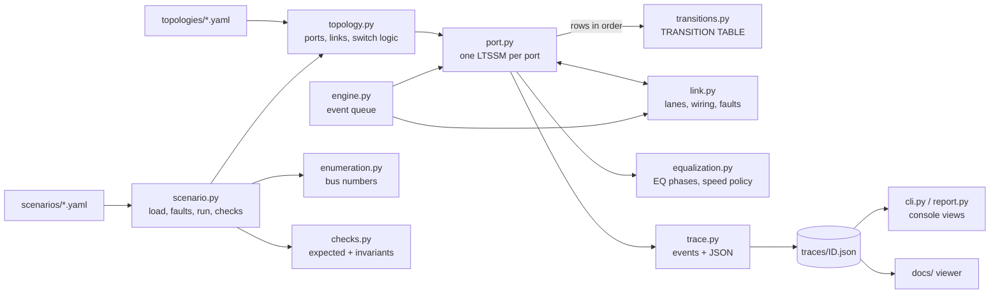
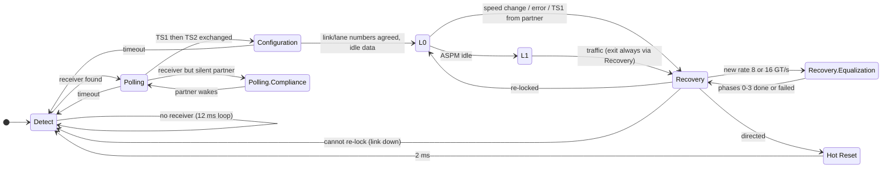

# How it works

This guide explains how the simulator is built and walks through a healthy
Gen4 bring-up step by step, using the trace of scenario S01. Read it with
`python -m ltssm run S01 --trace --port RP,USP` open next to it.

The model is a **behavioral model for learning and demonstration**. It is not
spec-accurate, not cycle-accurate, and not derived from the PCI-SIG
specification text. The rules and numbers are simplified on purpose so that
the cause-and-effect stays visible.

## Contents

1. [Architecture](#architecture)
2. [The discrete-event engine](#the-discrete-event-engine)
3. [Ordered sets and bursts](#ordered-sets-and-bursts)
4. [The transition table](#the-transition-table)
5. [The state machine at a glance](#the-state-machine-at-a-glance)
6. [Speed change and equalization](#speed-change-and-equalization)
7. [Switch behavior and enumeration](#switch-behavior-and-enumeration)
8. [A Gen4 bring-up, narrated](#a-gen4-bring-up-narrated)
9. [Simplifications](#simplifications)

## Architecture



| Module | What it holds |
|---|---|
| `states.py` | The substates (`Detect.Quiet`, `Recovery.RcvrLock`, ...) and their families. |
| `config.py` | Every timeout, count and policy option, all marked as simplified. |
| `ordered_sets.py` | Symbolic TS1, TS2, EIOS, EIEOS, SKP, FTS and idle data; per-lane receive counters. |
| `transitions.py` | The transition table and what each substate transmits. **Start reading here.** |
| `port.py` | One LTSSM: evaluates the table, keeps Link Status fields (speed, width, Link Training, DL_Link_Active). |
| `link.py` | The channel between two ports: lane mapping, faults, link counters. |
| `equalization.py` | Symbolic preset search (figure of merit) and the speed-change policy. |
| `topology.py` | Builds ports, links and the switch hold/release and Hot Reset propagation logic. |
| `enumeration.py` | Depth-first bus numbering and the `lspci -t`-style tree. |
| `engine.py` | The discrete-event scheduler. |
| `trace.py` | Trace events and JSON export. |
| `scenario.py`, `checks.py` | Scenario files, fault injection, expected-vs-actual checks and global invariants. |
| `cli.py`, `report.py` | Command line and console formatting (ASCII only). |

## The discrete-event engine

Nothing in the model waits in real time. The engine is a priority queue of
`(t_ns, seq, callback)` entries. `run()` pops the earliest one, moves the
global clock to its time and calls it; the callback may schedule more
entries. A 12 ms timeout costs one queue entry. `seq` breaks ties in the
order entries were scheduled, which makes every run deterministic: the same
scenario and seed always give a byte-identical trace (there is a test for
that).

Three kinds of things are scheduled:

* **timers**: a substate timeout, the DL_Link_Active delay, the next speed
  step, an equalization preset trial;
* **bursts**: a port's transmitter sending ordered sets, and the link
  delivering them to the partner a few nanoseconds later;
* **faults and commands** from the scenario file (an error at 32 ms, a Hot
  Reset at 35 ms).

All times are integers in nanoseconds.

## Ordered sets and bursts

An ordered set is a small immutable object with the fields the model needs:
`type`, `link_num`, `lane_num` (`None` is shown as PAD), `rates`,
`speed_change`, `eq_phase` (the EC field), `preset`, and the Hot Reset,
Disable and Loopback bits. Unused fields are `None`.

Sending ordered sets one by one would cost millions of events, so a port
sends a **burst**: 32 identical ordered sets per lane in one event (about
2.0 us at 2.5 GT/s, 0.26 us at 16 GT/s). After 16 bursts in the same
substate the bursts are batched 8 times larger, because nothing new is
being said; the counts stay exact.

The receiver keeps, per lane, the last ordered set and how many identical
ones arrived in a row. Rules such as "8 consecutive TS1" are checked
against those counts. Two details matter when you read traces:

* Counts restart when a port enters a new substate, but once a run of 8 is
  reached in a substate it stays *latched* even if the partner has moved
  on. Two ports never move at exactly the same time, and this is what lets
  them meet.
* A dropped or corrupted ordered set (a lane fault) breaks the run. A lane
  with a 50 percent error rate rarely sees 8 in a row, which is how the
  model reproduces "cannot get symbol lock on that lane".

The **Link** applies the wiring and faults on the way: open lanes carry
nothing (and present no receiver termination), reversed wiring maps lane i
to lane N-1-i, per-lane error rates use the link's seeded random generator,
and a broken transmitter can be told to send TS1 where it should send TS2.

## The transition table

`ltssm/transitions.py` is one list of rows. Each row says:

| Column | Example (row T05) |
|---|---|
| `rule_id` | `T05` (printed in every trace event as `"rule": "T05"`) |
| `src` | `Polling.Active` |
| `role` | `any` (some rows are only for the DSP or only for the USP) |
| `event` | `polling_active_done` (the port method `cond_polling_active_done`) |
| `guard` | "sent >= 1024 TS1 AND received 8 consecutive TS1/TS2 on every lane being trained" |
| `dst` | `Polling.Configuration` |
| `action` | optional bookkeeping, for example `assign_lane_numbers` |
| `rule` | the behavior in one sentence |
| `optional` | `True` when no built-in scenario uses the row (unit tests cover it) |

`Port.evaluate()` is the only place a port changes substate:

```
for row in TABLE_BY_SOURCE[current substate], in table order:
    if the row's role matches this port:
        reason = port.cond_<event>()        # None, or a human-readable reason
        if reason:
            port.act_<action>()             # if the row has an action
            enter row.dst, log (reason, rule id)
            evaluate again                  # some substates exit at once
```

Conditions only read state; actions change it. Row order is priority: in
L0 a pending Hot Reset (T24) is checked before a receiver error (T28),
which is checked before a voluntary speed change (T30). A unit test removes
row T22 from the table and shows that the link can no longer reach L0, so
there is no hidden second state machine. Another test checks that every
non-optional row fires in at least one scenario, and that every optional row
fires in one of the unit-test exercises.

The full table is in [transition-table.md](transition-table.md) (regenerate
it with `python -m ltssm table --markdown`).

## The state machine at a glance



Families and timeline colors: Detect (grey), Polling (amber), Configuration
(purple), L0 (green), Recovery (blue), Equalization (teal), L0s/L1/L2
(indigo), Polling.Compliance / Hot Reset / Disabled / Loopback (red).

## Speed change and equalization

Every link trains at 2.5 GT/s first. In the model the downstream-facing
port (DSP: a root port or switch downstream port) then decides whether to
go faster (on real links either port may initiate a speed change):

1. In L0, after a short delay, the DSP checks its speed policy
   (`equalization.next_speed_step`): the target is the lowest of its own
   maximum, the partner's advertised maximum, its Target Link Speed
   (LnkCtl2) and its *rate ceiling* (lowered after failures).
2. With `gen2_step: false` (default) it goes Gen1 -> Gen3 -> Gen4. With
   `gen2_step: true` it visits every rate. 16 GT/s is never tried before
   8 GT/s equalization is complete.
3. It enters Recovery.RcvrLock with `speed_change=1` in its TS1s and
   advertises rates only up to the step it wants. The USP echoes the bit.
4. In Recovery.RcvrCfg both sides see 8 TS2 with `speed_change=1`; the new
   rate is the highest rate both advertised.
5. Recovery.Speed: EIOS, electrical idle, switch rate, back to RcvrLock.
6. At 8 or 16 GT/s without equalization at that rate, RcvrLock goes
   straight to equalization:

| Phase | Who leads | What happens in the model |
|---|---|---|
| 0 | USP only | The USP transmits with its starting preset until it hears the DSP (TS1 with EC=01). |
| 1 | both | Both send TS1 with EC=01; each moves on when it hears the other. |
| 2 | **USP requests** | The USP asks the DSP's transmitter to try presets and judges each with its own receiver (downstream direction). |
| 3 | **DSP requests** | The DSP asks the USP's transmitter to try presets and judges them (upstream direction). |

Each preset trial takes 400 us and produces a symbolic figure of merit
(FOM, 0 to 100) from the rate, the preset and a seeded wobble. A trial
passes at FOM 60. An `eq_fail` fault subtracts a large penalty, so no
preset passes; after 6 trials the requester gives up, sends EIOS, and both
ports go to Recovery.Speed and **revert** to the rate they came from.
After `eq_max_attempts` (2) failures at a rate the DSP lowers its rate
ceiling below it, logs why, and tries the next lower untried rate.

Status bits mirror the real registers: `eq_8gt_complete` and
`eq_16gt_complete`, the per-phase success bits, and the Link Equalization
Request bit (set after a failure in the model). All of them clear when the
link goes through Detect. In the model the Complete bit stays clear after a
failed attempt; on real hardware it may read + after an unsuccessful
attempt depending on the implementation, so check the per-phase bits and
Link Equalization Request first.

## Switch behavior and enumeration

The switch has one upstream port (USP) and three downstream ports. With
`dsp_start: wait_for_upstream` (default) the model shows the downstream
ports as held in Detect.Quiet until link A reaches L0. A real switch keeps
such ports in reset, which is why their receiver termination is
high-impedance; endpoints behind them see "no receiver" during that time. With
`dsp_start: together` all ports start at power-on. When the USP enters Hot
Reset (or link A goes down), the switch directs Hot Reset to every
downstream port in L0 and holds them again until link A is back.

After the run, `enumeration.py` walks the hierarchy depth-first like boot
firmware: bridges (root port, switch ports) get primary, secondary and
subordinate bus numbers; a function behind a link without DL_Link_Active
reads as Vendor ID 0xFFFF and is skipped. The basic topology gives:

```
-[0000:00]---01.0-[01-05]----00.0-[02-05]--+-00.0-[03]----00.0
                                           +-01.0-[04]----00.0
                                           \-02.0-[05]--
```

## A Gen4 bring-up, narrated

Times below are from `traces/S01.json`, link A (RP = root port, USP =
switch upstream port). The rule id after each step is the table row.

| t (ms) | Port(s) | What happens | Rule |
|---|---|---|---|
| 0 | all | PERST# released; every LTSSM starts in Detect.Quiet. Switch downstream ports are held. | init |
| 12.000 | RP, USP | The 12 ms Detect.Quiet timer expires: receiver detection. | T01 |
| 12.001 | RP, USP | Termination found on lanes 0-15: Polling.Active, sending TS1 with PAD link/lane numbers. | T03 |
| 12.064 | RP, USP | 1024 TS1 sent and 8 consecutive TS1 received on all 16 lanes: Polling.Configuration, sending TS2. | T05 |
| 12.067 | RP, USP | 8 TS2 received and >= 16 sent after the first (the trace shows 32 because ordered sets go out in bursts of 32): Configuration.Linkwidth.Start. | T10 |
| 12.067 | USP, RP | RP proposes link number 1; USP accepts and echoes it. | T13, T12 |
| 12.069 | RP | Echo seen on lanes 0-15: **width x16 chosen**, lane numbers 0-15 proposed. | T15 |
| 12.069 | USP, RP | Lane numbers received, echoed and confirmed; Configuration.Complete (TS2 with supported rates). | T16-T20 |
| 12.071 | RP, USP | Partner advertises up to Gen4; Configuration.Idle (idle data). | T21 |
| 12.075 | RP, USP | 8 idle symbols received: **L0 at 2.5 GT/s x16**. DL_Link_Active rises 5 us later. | T22 |
| 12.075 | switch | Link A is up, so DSP1-3 are released and start their own 12 ms quiet timers. | status |
| 12.095 | RP | Speed policy: go to 8.0 GT/s first. Recovery.RcvrLock with speed_change=1. USP follows. | T30, T29 |
| 12.097 | RP | RcvrCfg: both want to change speed; Recovery.Speed (EIOS, idle, switch to 8 GT/s). | T44, T53 |
| 12.099 | RP | At 8 GT/s without equalization: RcvrLock -> Equalization Phase 1 (USP starts in Phase 0). | T56, T43, T42 |
| 12.101 | both | Phase 0/1 handshake (EC=01, then EC=10): both in Phase 2. | T58-T60 |
| 12.501 | USP | Phase 2: the USP tried RP's preset P7, FOM 80 >= 60: accepted. Phase 3. | T61, T63 |
| 12.901 | RP | Phase 3: the RP tried the USP's preset P7, FOM 81: accepted. **8 GT/s EQ complete.** | T64, T66 |
| 12.903 | both | RcvrLock -> RcvrCfg -> Recovery.Idle -> **L0 at 8.0 GT/s**. | T44, T54, T70 |
| 12.923 | RP | Next step: 16 GT/s. Same Recovery path, Recovery.Speed to 16 GT/s. | T30, T53, T56 |
| 12.925-13.726 | both | Equalization at 16 GT/s: phases 0-3; FOM about 65 (less margin than at 8 GT/s). **16 GT/s EQ complete.** | T42-T66 |
| 13.726 | both | **L0 at 16.0 GT/s x16.** link A counters: recovery_count 2, flap_count 0. | T70 |
| 24.0-25.7 | DSP1/EP1, DSP2/EP2 | The downstream links repeat the same story. EP1 and EP2 each logged one failed detection at 12 ms, while their switch ports were still held. | |

What the trace shows at each stage is listed in
[what-to-expect.md](what-to-expect.md); what it means when something
deviates is in [debug-guide.md](debug-guide.md).

## Simplifications

* Timeouts and ordered-set counts are approximate and configurable
  (`ltssm/config.py`); Recovery timeouts are 2 ms instead of the larger
  values textbooks quote.
* Ordered sets are symbolic objects sent in bursts, not encoded bits.
* Equalization is pass/fail per phase with symbolic presets and a symbolic
  figure of merit, not real coefficients or eye measurements.
* No data link or transaction layer; DL_Link_Active is a timed flag; the
  ASPM handshake (PM DLLPs) is symbolic.
* L0s is transmit-side only; L2, Loopback and Disabled are minimal; Hot
  Reset, Disabled and Loopback are entered from Recovery.RcvrCfg.
* Receiver detection is all-or-nothing per lane; there is no 12 ms
  re-detection when only some lanes answer.
* Width is the widest supported width that starts at lane 0; a dead lane 0
  is not rescued by reversal.
* Not validated against the PCI-SIG specification text.
